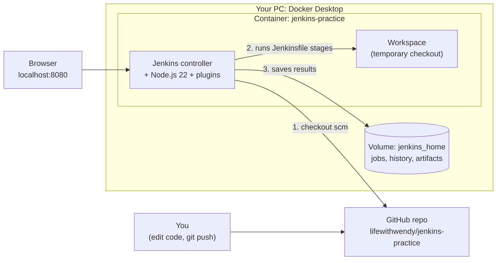

# 001: How it all fits together

A short tour of the pieces in this repo and what happens, in order, when you build.

## The big picture

## The pieces

| File / thing | Role |
| --- | --- |
| `jenkins/Dockerfile` | Builds our Jenkins image: official Jenkins LTS, plus Node.js 22 so builds can run `npm`, plus the plugins. |
| `jenkins/plugins.txt` | Plugins baked into the image (Pipeline, Git, JUnit, Configuration as Code, ...). Jenkins does almost everything through plugins. |
| `jenkins/casc/jenkins.yaml` | Configuration as Code: creates the admin user, sets executors and the URL. Replaces the setup wizard. |
| `docker-compose.yml` | Starts the container: maps port 8080, passes the login from `.env`, mounts the CasC file, and keeps data in the `jenkins_home` volume. |
| `.env` | Your admin login. Never committed (`.gitignore`). |
| `Jenkinsfile` | The pipeline as code: which stages run, in which order, and what to do after. Jenkins reads it from the repo on every build. |
| `app/` | The thing being built: a tiny Node.js web app with 5 tests. |
| Pipeline job (in the UI) | Points Jenkins at the repo and says "use the Jenkinsfile". This is the only part configured by clicking. |

## What happens when you click Build Now

1. **Job starts.** Jenkins picks a free executor (one of 2 on the controller) and creates a fresh workspace folder.
2. **Checkout.** `checkout scm` clones the repo and branch configured in the job (`main`).
3. **Build.** `npm ci` installs exactly what `package-lock.json` says, then `npm run lint` checks syntax.
4. **Test.** `npm test` runs the tests and writes `test-results.xml`. The `junit` step turns that into the **Tests** page and trend chart. If a test fails, the build turns red here and later stages are skipped.
5. **Package.** `npm pack` makes `jenkins-practice-app-1.0.0.tgz`, and `archiveArtifacts` stores it with the build.
6. **Post actions.** A pass/fail message is logged, and `cleanWs()` deletes the workspace. Logs, test results and artifacts stay in `jenkins_home`.

## What lives where

- **In git:** everything needed to recreate the setup (image, config, pipeline, app).
- **In the `jenkins_home` volume:** runtime state such as jobs, build history, logs and artifacts. It survives `docker compose down`, but `docker compose down -v` deletes it.
- **Temporary:** the workspace, wiped after each build.

## How builds get triggered

- **Manually:** Build Now.
- **Polling:** the job checks GitHub on a schedule (`H/2 * * * *`) and builds when it finds new commits.
- **Webhooks** (GitHub calls Jenkins on push) need Jenkins to be reachable from the internet, so they don't work on `localhost` without a tunnel.

## Simplifications to know about

- Builds run on the controller. Real setups run them on separate **agents**, so the controller only schedules work.
- Plugins use `latest`. Pin versions for reproducible images.
- "Package" means a `.tgz`. A common next step is building and pushing a Docker image instead.
